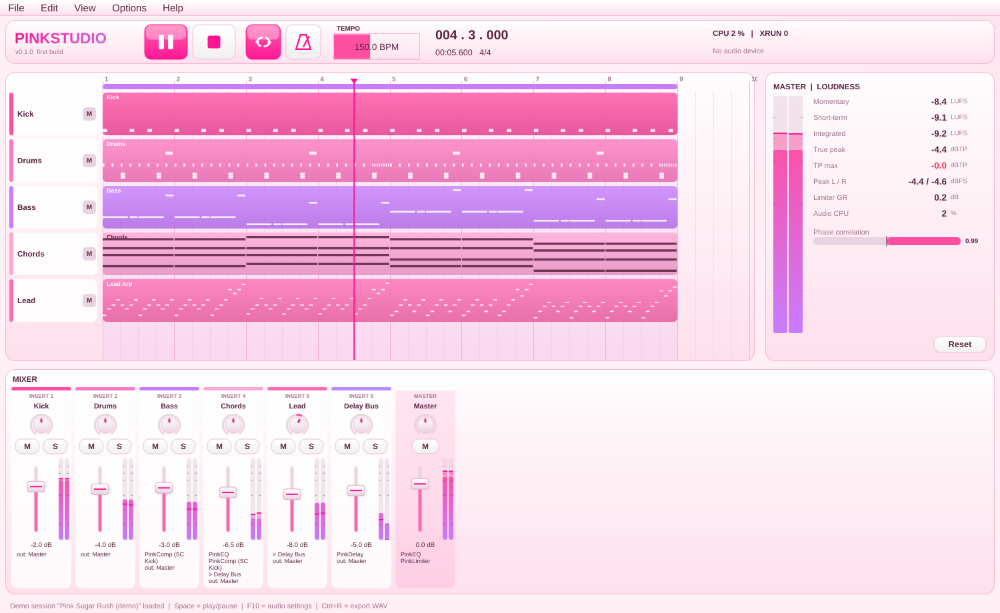

# PINKSTUDIO

DAW per Windows 10/11 x64 in C++20 + JUCE 8, con identità grafica rosa kawaii.



## Stato: versione 0.1.0 — fasi 1 e 2 completate

Questa è la **prima build funzionante**, non la DAW completa. Ogni funzione presente fa davvero
quello che dice; tutto ciò che non è ancora implementato **non compare nell'interfaccia** ed è
elencato in [`docs/ROADMAP.md`](docs/ROADMAP.md).

Cosa funziona oggi:

- **Motore audio real-time** indipendente dalla GUI: lock-free, nessuna allocazione nel callback
  audio (verificato da test), eventi MIDI con precisione al campione con qualsiasi buffer size.
- **Driver**: ASIO, WASAPI (shared ed exclusive), DirectSound tramite JUCE; selezione dispositivo,
  canali, sample rate, buffer size, ingressi MIDI, tono di test, meter di test degli ingressi.
- **Transport**: play/pausa, stop (torna al punto di partenza), loop con precisione al campione,
  metronomo con accento, tempo e indicazione di tempo (con mappa dei cambi nel motore).
- **Mixer**: master + 128 insert (configurabile fino a 512), fader, pan (balance stereo / constant
  power mono), mute, solo intelligente, inversione di fase, mono, 8 send pre/post fader, bus,
  sidechain, 10 slot di insert, routing senza cicli (verificato), meter peak/RMS.
- **Master**: loudness LUFS momentary/short-term/integrated (ITU-R BS.1770-4), true peak con
  oversampling 4x, correlazione di fase, riduzione di guadagno del limiter, CPU.
- **Plugin stock con DSP reale**: PinkEQ (8 bande), PinkComp (soft knee, RMS/peak, sidechain,
  mix parallelo), PinkLimiter (look-ahead brick-wall), PinkDelay (sync, ping-pong), PinkUtility.
- **Strumenti**: PinkSynth (polifonico, unison, filtro SVF, 2 inviluppi, LFO, pedale sustain),
  PinkDrum (kick, snare, clap, hi-hat con choke, 808 sintetizzati).
- **Export WAV** offline (16/24/32-bit float) con lo stesso motore del playback.
- **Interfaccia**: 4 temi (Pink Default, Dark Pink, Cyber Pink, Pastel), panoramica arrangement
  (clic per spostare il playhead, trascina sul righello per il loop, mute traccia), mixer, sezione
  master, scorciatoie da tastiera personalizzabili, undo/redo.
- **Sessione demo** "Pink Sugar Rush" (150 BPM): da premere Play e ascoltare.

## Ottenere PINKSTUDIO.exe

Questo ambiente di sviluppo è Linux e non può eseguire il compilatore Microsoft: il file `.exe`
va compilato su Windows. Hai tre strade, tutte già pronte:

1. **GitHub Actions (consigliata, non serve installare niente)**: carica questa cartella in un
   repository GitHub. Il workflow `.github/workflows/windows-build.yml` compila, esegue i test,
   crea `PINKSTUDIO_SETUP.exe` e lo mette negli *Artifacts* dell'esecuzione.
2. **Sul tuo PC**: installa Visual Studio 2022+ (carico di lavoro C++) e Git, poi fai doppio clic su
   `scripts\build_windows.bat`.
3. **A mano**: `cmake -S . -B build -A x64` e poi `cmake --build build --config Release`.

Dettagli e risoluzione problemi: [`docs/BUILD_WINDOWS.md`](docs/BUILD_WINDOWS.md).

## Documentazione

| File | Contenuto |
|---|---|
| [`docs/BUILD_WINDOWS.md`](docs/BUILD_WINDOWS.md) | Guida a compilazione e installazione |
| [`docs/USER_GUIDE.md`](docs/USER_GUIDE.md) | Guida all'utilizzo |
| [`docs/FORMATS.md`](docs/FORMATS.md) | Formati supportati (oggi e in arrivo) |
| [`docs/TEST_REPORT.md`](docs/TEST_REPORT.md) | Report dei test eseguiti |
| [`docs/ARCHITECTURE.md`](docs/ARCHITECTURE.md) | Architettura del motore e dell'app |
| [`docs/ROADMAP.md`](docs/ROADMAP.md) | Stato di ogni funzione del master prompt, fase per fase |
| [`docs/LICENSES.md`](docs/LICENSES.md) | Licenze delle dipendenze |

## Struttura

```
engine/      motore audio (C++20 puro, nessuna dipendenza): transport, mixer, DSP, strumenti, I/O
app/         applicazione JUCE: driver audio/MIDI, interfaccia, temi, comandi
tests/       39 test automatici del motore (DSP, timing, routing, real-time safety, thread safety)
tools/       pinkrender: render offline da riga di comando
installer/   script Inno Setup per PINKSTUDIO_SETUP.exe
scripts/     build_windows.bat
.github/     workflow di compilazione Windows
docs/        documentazione
```
