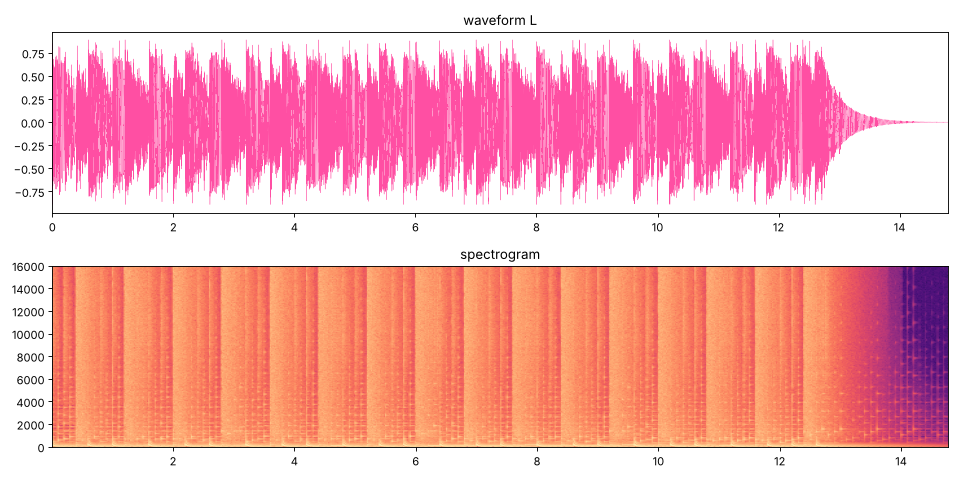

# Report dei test — PINKSTUDIO 0.1.0

Data: 21 novembre 2026. Tutti i numeri qui sotto sono stati prodotti dai test, non scritti a mano.

## Riepilogo

| Verifica | Ambiente | Esito |
|---|---|---|
| 39 test del motore, build Release | Linux x64, GCC 13.3, `-O3` | ✅ 39/39 |
| Stessi test con AddressSanitizer + UndefinedBehaviorSanitizer + LeakSanitizer | GCC 13.3 | ✅ 39/39, nessun errore, nessun leak |
| Stessi test con ThreadSanitizer (snapshot, code, modifiche live durante il playback) | GCC 13.3 | ✅ 39/39, nessuna data race |
| Nessuna allocazione nel callback audio (3000 blocchi con demo, metronomo, MIDI live, locate, stop, panic) | `operator new` strumentato | ✅ 0 allocazioni |
| Loudness e true peak confrontati con uno strumento indipendente (FFmpeg `ebur128`) sul render della demo | FFmpeg 6.1 | ✅ vedi sotto |
| Applicazione JUCE: compilazione e link completi contro JUCE 8.0.15 | Linux x64, GCC 13.3, LTO | ✅ 0 errori; 1 warning voluto (`-Wfloat-equal`) |
| Applicazione JUCE: avvio senza display, playback headless, screenshot dei 4 temi | Xvfb | ✅ exit code 0, immagini in `docs/images/` |
| Compilazione con MSVC, avvio di `PINKSTUDIO.exe`, driver ASIO/WASAPI reali, installer Inno Setup | Windows | ⏳ **non eseguibili in questo ambiente**: li esegue il workflow GitHub Actions a ogni push |

## Confronto con FFmpeg (render della demo, 48 kHz / 24 bit)

| Misura | Meter PINKSTUDIO | FFmpeg `ebur128=peak=true` |
|---|---|---|
| Loudness integrata | −9,19 LUFS | −9,2 LUFS |
| True peak | −0,04 dBTP | +0,1 dBTP |
| Sample peak | −1,00 dBFS (ceiling del limiter −1,0) | — |

La differenza di 0,14 dB sul true peak deriva dai diversi filtri di interpolazione 4x; entrambi
indicano che il limiter (che oggi limita il *sample* peak) lascia passare overs inter-campione di
circa 1 dB. Il **True Peak Limiter** è previsto nella fase 8.



## Come ripetere i test

```bash
cmake -S . -B build -DPINKSTUDIO_BUILD_APP=OFF && cmake --build build
./build/tests/pinkstudio_tests --report report.md
# sanitizer
cmake -S . -B build-asan -DPINKSTUDIO_BUILD_APP=OFF -DPINKSTUDIO_SANITIZE=ON
cmake -S . -B build-tsan -DPINKSTUDIO_BUILD_APP=OFF -DPINKSTUDIO_TSAN=ON
```

Su Windows: `ctest --test-dir build -C Release` oppure il workflow, che allega `test-report.md`.

## Risultati e misure (build Release Linux)

| Test | Result |
|---|---|
| `spsc_queue_basic_wrap_and_full` | PASS |
| `spsc_queue_two_threads_keeps_order` | PASS |
| `snapshot_exchange_concurrent_publish_never_frees_in_use` | PASS |
| `midi_event_list_is_sorted_and_stable` | PASS |
| `parameter_mapping_and_clamping` | PASS |
| `undo_redo_transactions_and_budget` | PASS |
| `tempo_map_conversions` | PASS |
| `time_signature_bars_and_beats` | PASS |
| `biquad_peak_and_lowpass_responses` | PASS |
| `parametric_eq_measured_matches_design` | PASS |
| `compressor_static_curve` | PASS |
| `compressor_steady_state_gain_reduction` | PASS |
| `compressor_external_sidechain` | PASS |
| `limiter_never_exceeds_ceiling` | PASS |
| `delay_tempo_sync_position` | PASS |
| `utility_mono_and_phase` | PASS |
| `k_weighting_matches_bs1770_at_48k` | PASS |
| `lufs_calibration_1khz_sine` | PASS |
| `lufs_gating_absolute_and_relative` | PASS |
| `true_peak_detects_intersample_overs` | PASS |
| `phase_correlation` | PASS |
| `synth_pitch_is_accurate` | PASS |
| `synth_polyphony_and_voice_limit` | PASS |
| `synth_release_reaches_silence` | PASS |
| `synth_sustain_pedal_holds_notes` | PASS |
| `drum_pieces_trigger_and_choke` | PASS |
| `engine_events_are_sample_accurate_for_any_block_size` | PASS |
| `engine_loop_wrap_sends_note_off_and_retriggers` | PASS |
| `engine_stop_releases_notes_and_returns_to_start` | PASS |
| `engine_fader_pan_mute_and_sends` | PASS |
| `engine_solo_mutes_unrelated_channels` | PASS |
| `mixer_rejects_feedback_routing` | PASS |
| `engine_sidechain_ducks_target` | PASS |
| `engine_metronome_clicks_on_beats` | PASS |
| `engine_audio_callback_does_not_allocate` | PASS |
| `engine_survives_concurrent_edits` | PASS |
| `offline_render_demo_to_wav_and_read_back` | PASS |
| `wav_round_trip_all_formats` | PASS |
| `audio_clip_playback_with_resampling` | PASS |

| Test | Measurement | Value |
|---|---|---|
| `snapshot_exchange_concurrent_publish_never_frees_in_use` | audio blocks run during 20000 publishes | 176717 |
| `tempo_map_conversions` | worst PPQ round-trip error | 1.42109e-14 |
| `biquad_peak_and_lowpass_responses` | 2nd-order LP 1 kHz: attenuation at 10 kHz (dB) | -42.7383 |
| `parametric_eq_measured_matches_design` | EQ measured gain at 40 Hz (dB) | -12.2949 |
| `parametric_eq_measured_matches_design` | EQ measured gain at 200 Hz (dB) | 0.156316 |
| `parametric_eq_measured_matches_design` | EQ measured gain at 1000 Hz (dB) | 5.99981 |
| `parametric_eq_measured_matches_design` | EQ measured gain at 5000 Hz (dB) | 0.248597 |
| `compressor_steady_state_gain_reduction` | -10 dBFS sine, T=-20, R=4: output peak (dBFS, ideal -17.5) | -17.2478 |
| `compressor_steady_state_gain_reduction` | same with 50 % parallel mix: output peak (dBFS) | -12.8889 |
| `compressor_external_sidechain` | sidechain ducking depth (dB) | -21.5814 |
| `limiter_never_exceeds_ceiling` | limiter: max output (dBFS, ceiling -1.0) | -1.00009 |
| `limiter_never_exceeds_ceiling` | limiter: latency (samples @48k) | 71 |
| `delay_tempo_sync_position` | 1/8 dotted @120 BPM echo position (samples, ideal 18000) | 18000 |
| `lufs_calibration_1khz_sine` | stereo 1 kHz sine @ -20 dBFS: integrated (LUFS, ideal -20.00) | -19.9933 |
| `lufs_calibration_1khz_sine` | 1 kHz sine @ -20 dBFS left only (LUFS, ideal -23.01) | -23.0036 |
| `lufs_gating_absolute_and_relative` | 10 s @-20 + 10 s silence + 10 s @-40: integrated (LUFS, ideal -20) | -20.0589 |
| `true_peak_detects_intersample_overs` | fs/4 sine: sample peak (dBFS) | -3.0103 |
| `true_peak_detects_intersample_overs` | fs/4 sine: true peak (dBTP, ideal 0.0) | -0.0524425 |
| `phase_correlation` | correlation of independent noise | 0.00831079 |
| `synth_pitch_is_accurate` | A4 (MIDI 69) measured frequency (Hz) | 440 |
| `synth_pitch_is_accurate` | A4 + pitch bend +2 st (Hz, ideal 493.86) | 493.876 |
| `drum_pieces_trigger_and_choke` | PinkDrum note 35 (bass808) peak dBFS | -5.52323 |
| `drum_pieces_trigger_and_choke` | PinkDrum note 36 (kick) peak dBFS | -1.55701 |
| `drum_pieces_trigger_and_choke` | PinkDrum note 38 (snare) peak dBFS | -3.12786 |
| `drum_pieces_trigger_and_choke` | PinkDrum note 39 (clap) peak dBFS | -12.5136 |
| `drum_pieces_trigger_and_choke` | PinkDrum note 42 (hat_closed) peak dBFS | -16.399 |
| `drum_pieces_trigger_and_choke` | PinkDrum note 46 (hat_open) peak dBFS | -18.2792 |
| `drum_pieces_trigger_and_choke` | open hat tail energy reduction by choke (dB) | -79.0134 |
| `engine_events_are_sample_accurate_for_any_block_size` | note on/off positions identical for blocks 64/512/1000/4096 | yes |
| `engine_sidechain_ducks_target` | sidechain ducking in mixer (dB) | -20.9819 |
| `engine_audio_callback_does_not_allocate` | heap allocations inside 3000 audio callbacks (demo session) | 0 |
| `engine_audio_callback_does_not_allocate` | channels processed (of 129) | 7 |
| `engine_survives_concurrent_edits` | audio blocks processed during 400 live commits | 182 |
| `offline_render_demo_to_wav_and_read_back` | demo render length (s) | 14.3 |
| `offline_render_demo_to_wav_and_read_back` | demo render speed (x real time) | 26.5841 |
| `offline_render_demo_to_wav_and_read_back` | demo sample peak (dBFS) | -1.00009 |
| `offline_render_demo_to_wav_and_read_back` | demo true peak (dBTP) | -0.0371933 |
| `offline_render_demo_to_wav_and_read_back` | demo integrated loudness (LUFS) | -9.19166 |
| `audio_clip_playback_with_resampling` | 441 Hz clip recorded at 44.1 kHz, played at 48 kHz (Hz) | 441 |

Total: 39 passed, 0 failed

